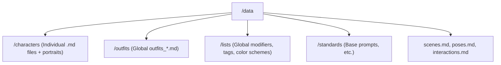

# Logic Blueprint: Prompt Builder Migration

This document serves as the structural audit for migrating the Tkinter-based Prompt Builder to a modern web framework (Flet).

## 1. The State Model (The "Backpack")

These variables represent the core state that must be preserved across user interactions and can be serialized for Undo/Redo or Presets.

| Variable Name             | Type         | Purpose                                                                                                           |
| :------------------------ | :----------- | :---------------------------------------------------------------------------------------------------------------- |
| `selected_characters`     | `List[Dict]` | Stores the roster of characters currently in the prompt, including their specific outfit, pose, and action notes. |
| `base_prompt`             | `String`     | The foundational style or context string (e.g., "Photorealistic", "Anime").                                       |
| `scene`                   | `String`     | The environmental description or background setting.                                                              |
| `notes`                   | `String`     | High-level interaction notes or "group actions" that apply to the whole scene.                                    |
| `metadata`                | `Dict`       | Internal tracking for scenarios, randomization seeds, or specific session flags.                                  |
| `undo_stack / redo_stack` | `List[Dict]` | Snapshots of the "Backpack" used to navigate history.                                                             |
| `preferences`             | `Dict`       | Persistent app settings: `ui_theme`, `ui_scale`, `favorite_characters`, and `recent_presets`.                     |

---

## 2. The Function Map (The Logic)

Business logic extracted from the UI controllers. These should remain framework-agnostic.

| Function Name          | Inputs             | Outputs                                                                  |
| :--------------------- | :----------------- | :----------------------------------------------------------------------- | ------------------------------------------------------------ |
| `generate_full_prompt` | `[State Dict]`     | `String` (The final raw prompt for the AI).                              |
| `generate_summary`     | `[State Dict]`     | `String` (A human-readable "natural language" summary).                  |
| `randomize`            | `[Optional Count]` | `State Dict` (A fully populated backpack based on a random scenario).    |
| `parse_import_text`    | `[String]`         | `State Dict` (Decoded state from a natural language summary).            |
| `validate_config`      | `[Selected Chars]` | `String                                                                  | None` (Error message if character combinations are invalid). |
| `sync_character_tags`  | `None`             | `None` (Updates the tag database by scanning all character `.md` files). |
| `calculate_ui_scale`   | `[Scale Name]`     | `Float` (Determines the multiplier for fonts and padding).               |

---

## 3. The UI Hierarchy (The Blocks)

The layout described in abstract functional blocks to guide the responsive Flet implementation.

### **Block A: The Global Toolbar (Header)**

- **Purpose:** Houses critical session-level actions.
- **Controls:** Randomize Button (Primary Action), Undo/Redo, Preset Load/Save, and the "Automation" trigger.

### **Block B: The Character Gallery (Sidebar)**

- **Purpose:** Browse, filter, and select from the full character library.
- **Key Components:**
  - **Real-time Search Bar:** Fuzzy matching across names, descriptions, and metadata.
  - **Multi-layered Filtering:** Categorized tag selection (Demographics, Body Type, Vibe) using "Pill" style chips.
  - **Character Cards (Tile View):**
    - **Async Photo Engine:** Lazy-loading and caching of character portrait images.
    - **Identity Badging:** Visual indicators for "Favorites" and "Used" status (characters already in roster).
    - **Quick Interactions:** "Add" (copies to roster), "Edit" (launches Character Creator), and "Favorite" toggle.

### **Block C: The Active Roster (Main Area)**

- **Purpose:** The primary "Work Table" where specific character instances are configured.
- **Key Components:**
  - **Accordion-style Character Items:** Each character in the roster has a collapsible entry to save vertical space.
  - **Identity Configuration:** Checkboxes for character-specific permanent traits (e.g., "Freckles", "Piercings").
  - **Outfit & Style Matrix:**
    - **Two-Step Selector:** Drill down from Category (e.g., "Sport", "Formal") to specific Outfit name.
    - **Dynamic Traits/Modifiers:** Checkboxes that update based on the _selected outfit_ (e.g., "Open Jacket", "Hood Up").
    - **Signature Color Logic:** Optional toggle to use a character's "Signature Color" if supported by the outfit code.
  - **Pose & Framing Control:**
    - **Pose Presets:** Category-based pose selection with a "Randomize Solo" button for quick variety.
    - **Framing Selector:** Dropdown for cinematic framing (Close-up, Full Body, Medium Shot).
    - **Custom Action Override:** A free-text area for manual pose/action descriptions that override presets.
  - **Interaction Tools:**
    - **Solo Randomizer:** A "Surprise Me" button for a single character to randomize outfit, pose, and traits.
    - **Manual Reordering:** Drag-and-drop or Arrow-button controls to change the character's order in the prompt.
  - **Bulk Editor (Collapsible):** A specialized tool to apply outfits, colors, or locking rules to all active characters at once.

### **Block D: The Context Sidebar (Utility Area)**

- **Purpose:** Define the "where" and "how" of the scene.
- **Sub-Blocks:**
  - **Scene Panel:** Text area + preset dropdown for environmental details.
  - **Interactions Panel:** Text area + preset dropdown for group poses/story beats.
  - **Live Summary:** A natural language read-out that updates in real-time.

---

## 4. The Parser Engine (Logic Facade)

The application uses a "Facade" pattern in `logic/parsers.py` to delegate markdown processing to specialized classes.

| Component           | Responsibility                                                                                                                                       |
| :------------------ | :--------------------------------------------------------------------------------------------------------------------------------------------------- |
| **CharacterParser** | Extracts `Identity Locks`, `Traits`, and character-specific `Outfits` using specialized regex patterns.                                              |
| **OutfitParser**    | Parses complex, structured outfit definitions (e.g., Top, Bottom, Footwear) and supports nested modifiers.                                           |
| **PresetParser**    | Loads global templates for `Scenes`, `Poses`, and `Interactions`.                                                                                    |
| **DataLoader**      | Coordinates the entire "Boot-up" sequence: scans directories, handles legacy path migration, and merges shared outfits with character-specific ones. |

---

## 5. Prompt & Summary Logic

Prompt generation is handled by the `PromptConfig` and `PromptBuilder` in `core/builder.py`.

- **Prompt Generation (`generate`):**
  - Assembles the "Base Style", "Scene", "Character Roster", and "Action Notes" into a multi-block document.
  - **Substitution Engine:** Dynamically replaces placeholders like `{primary_color}`, `{secondary_color}`, and `{signature_color}` based on the active color scheme.
- **Prompt Summary (`generate_summary`):**
  - Creates a "Natural Language" digest using emojis (🎨 🎬 👥).
  - Extracts key information: Art Style, Scene description, and the "Outfit • Team • Pose" summary for each character.

---

## 6. The Visual Brain (ThemeManager)

The `ThemeManager` in `ui/themes/theme_manager.py` acts as the central styling authority.

- **Registration System:** Components register themselves with the manager to receive reactive updates when the theme (Dark/Light/Custom) or UI Scale changes.
- **Theme Format:** Themes are defined in `.md` files as key-value pairs (e.g., `accent: #0078d7`, `panel_bg: #1e1e1e`), allowing users to create custom skins without touching code.
- **Hierarchy:** Handles global CSS-like styling for Tkinter widgets (TFrame, TLabel) while providing "manual overrides" for complex custom canvas elements.

---

## 7. Data Architecture (Folder Structure)

The application follows a strict hierarchical structure to separate content from logic.

### **Block E: The Output Console (Footer)**

- **Purpose:** The final delivery point for the user.
- **Features:** A non-editable (but clickable) text block showing the generated prompt, a "Copy" button, and a "Magic Wand" (**Generate**) button.

---

## 8. The Automation Engine (AI Studio)

The "Generate" button above the output console triggers an automated end-to-end generation flow.

1.  **Trigger:** `generate_current_image` (in `MenuActions`) extracts the current prompt from the `PreviewPanel`.
2.  **Controller:** The `AutomationController` (in `logic/automation_controller.py`) launches a background worker thread to keep the UI responsive.
3.  **Client:** The `AIStudioClient` (using `asyncio` and browser automation) manages a Chrome instance with a persistent user profile.
4.  **Workflow:**
    - Navigates to the AI Studio website.
    - Simplified "Headless-adjacent" mode: The browser is usually visible but automated.
    - Injects the prompt, monitors the generation queue, and downloads the resulting image.
5.  **Feedback Sync:** Real-time progress updates (e.g., "Logging in...", "Generating...", "Saving image...") are piped back to the main UI's status bar via thread-safe callbacks.
